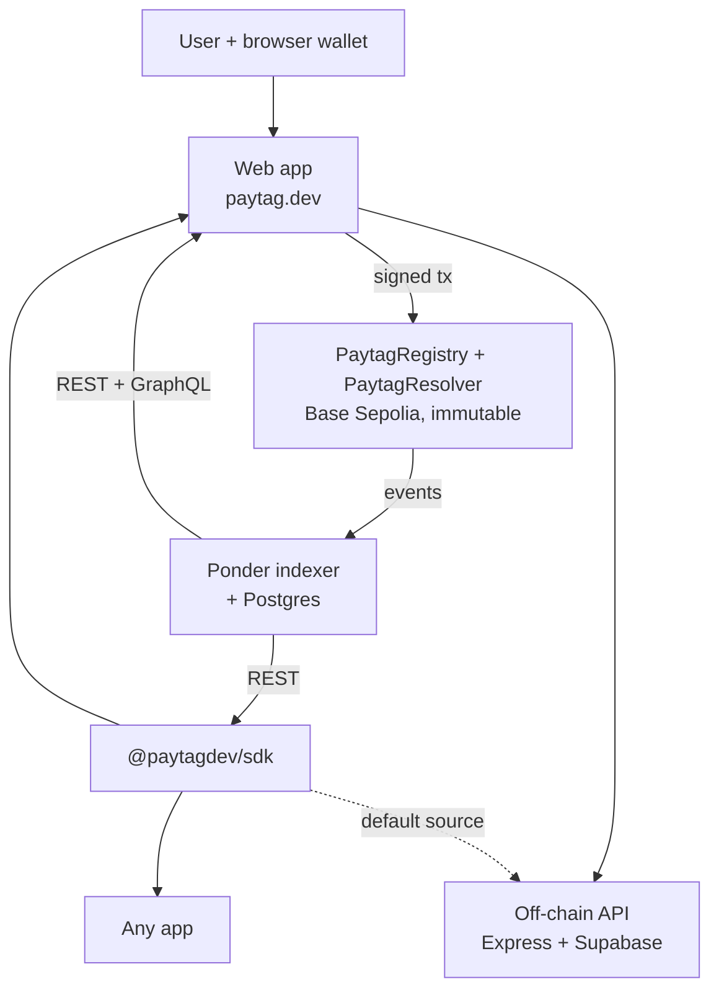
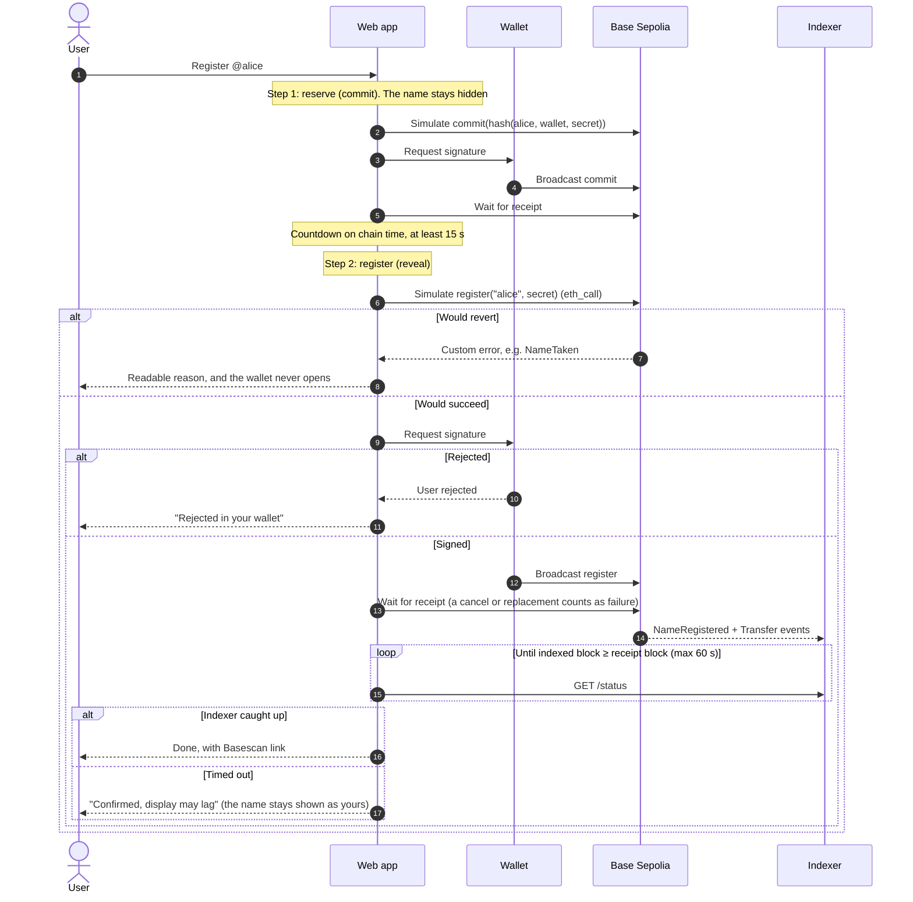

# Paytag

[](https://github.com/ansah25/paytag/actions/workflows/ci.yml) [](https://www.npmjs.com/package/@paytagdev/sdk)

> Username-to-wallet identity layer for multi-chain crypto payments.

Replace `0x4f3edf83…d8a3c2` with `@derrick`. Paytag maps one human-readable name to your addresses on Ethereum, Base, Solana and Bitcoin. Names live in an immutable, admin-free registry on Base; an indexer serves them over HTTP; an npm SDK resolves them in one call; a web app registers and manages them from your wallet.

### Try it (no wallet needed)

- **Resolve a name:** [paytag.dev/on-chain/derrick](https://www.paytag.dev/on-chain/derrick), or the raw API: [indexer.paytag.dev/resolve/derrick](https://indexer.paytag.dev/resolve/derrick)
- **Read the contracts:** [`PaytagRegistry`](https://sepolia.basescan.org/address/0x351fed5e079c421493a485c1b90cc115394c5cb7#code) and [`PaytagResolver`](https://sepolia.basescan.org/address/0x0b8bc41a7ce8cd5acd21e62a5be40ac281627f66#code), verified on Basescan
- **Check it's all up:** [paytag.dev/status](https://www.paytag.dev/status) (API, indexer lag vs. chain head, contracts, SDK version)
- **Run it locally** in three commands: [Quick start](#quick-start)

## Live

- **API:** [api.paytag.dev](https://api.paytag.dev/health). Try [`/resolve/derrick`](https://api.paytag.dev/resolve/derrick)
- **dApp:** <https://www.paytag.dev>. On-chain names at [`/on-chain`](https://www.paytag.dev/on-chain); live health at [`/status`](https://www.paytag.dev/status)
- **SDK:** [`@paytagdev/sdk`](https://www.npmjs.com/package/@paytagdev/sdk) on npm
- **On-chain indexer:** [indexer.paytag.dev](https://indexer.paytag.dev/status). Try [`/resolve/derrick`](https://indexer.paytag.dev/resolve/derrick) or [`/status`](https://indexer.paytag.dev/status)
- **Contracts (Base Sepolia):** [`PaytagRegistry`](https://sepolia.basescan.org/address/0x351fed5e079c421493a485c1b90cc115394c5cb7#code) · [`PaytagResolver`](https://sepolia.basescan.org/address/0x0b8bc41a7ce8cd5acd21e62a5be40ac281627f66#code)

## SDK

```bash
npm install @paytagdev/sdk
```

```ts
import { resolve } from '@paytagdev/sdk';

const user = await resolve('derrick');
// { username: 'derrick', addresses: { ethereum: '0x4f3edf83…', … } }
```

Zero config — the SDK ships with `https://api.paytag.dev` as the default base URL. To read on-chain state instead, use `resolveViaIndexer('derrick')`; it has the same shape plus `owner`, raw `records` and `source: 'onchain'`. See [`packages/sdk/README.md`](packages/sdk/README.md) for `resolveAddress`, `available`, custom clients, and error codes.

## Architecture



- **Base is canonical.** Ownership lives only in the registry; Solana, Bitcoin and other EVM chains are *records* on the name (ENSIP-9 coin types), never parallel deployments.
- **The contracts are immutable and admin-free.** The indexer is a read model that can be rebuilt from chain events at any time; it refuses to answer (503) until its backfill completes rather than serve partial data, and its API is rate-limited per IP.
- **One SDK, two sources.** `resolve()` reads the off-chain API (the original MVP), `resolveViaIndexer()` the on-chain registry, with the same response shape.
- **[`/status`](https://www.paytag.dev/status)** probes the API, the indexer (lag vs. chain head) and the contracts live.

The design decisions behind the records, normalization, reverse resolution and the v0.2 contract fixes are written up in [Why Paytag stores a Solana address as 32 raw bytes on Base](writing/cross-chain-records.md).

Every on-chain write in the app follows the same lifecycle (one hook, `useOnchainTx`, driven by a unit-tested state machine). Registration is shown: two transactions, a commit that hides the name and a reveal that claims it. Each write is simulated first, so failures surface before the wallet opens. Record edits work the same way, and on a timeout they keep the new value and re-check every 10 s until the indexer agrees:



| Layer | Choice |
|---|---|
| Contracts | Solidity 0.8.26, Foundry (unit, fuzz, invariant, gas snapshots) |
| Indexer | Ponder 0.18, Postgres, Hono API; self-hosted on Coolify |
| SDK | TypeScript, tsup (ESM + CJS), zero runtime dependencies |
| Web app | Next.js 14, wagmi v2 + viem, Vercel |
| Off-chain API | Node.js, Express, TypeScript, Zod, Supabase (Postgres + RLS), Fly.io |
| Tests | Foundry, Jest, Vitest; all in GitHub Actions |

## Quick start

Runs the web app on your machine against the live API and indexer (Node ≥ 20):

```bash
git clone --recurse-submodules https://github.com/ansah25/paytag && cd paytag
npm install
NEXT_PUBLIC_API_BASE_URL=https://api.paytag.dev npm run web:dev   # http://localhost:3002
```

On Windows PowerShell, set the variable first: `$env:NEXT_PUBLIC_API_BASE_URL="https://api.paytag.dev"; npm run web:dev`.

Everything on-chain works from there (look up, register, manage, with a Base Sepolia wallet), as does resolving and sending to off-chain names. Signing in to claim an off-chain name needs your own API, because the hosted one only accepts sign-ins from paytag.dev. If a page can't reach the hosted services, check [paytag.dev/status](https://www.paytag.dev/status); the full-local setup below runs without them.

<details>
<summary>Full-local setup: your own API, indexer and contracts</summary>

**API** (needs a Supabase project; the free tier is fine):

```bash
cp .env.example .env
# Fill in SUPABASE_URL, SUPABASE_SERVICE_ROLE_KEY, JWT_SECRET (32+ chars)
```

Apply the schema once in your Supabase SQL editor by running each file in [`supabase/migrations/`](supabase/migrations) in order (`0001_init.sql`, `0002_owner_wallet_unique.sql`, `0003_profiles_and_verification.sql`), then:

```bash
npm run dev       # API on http://localhost:3000
npm run web:dev   # web app on http://localhost:3002, using the local API by default
```

**Indexer** (Node ≥ 22.12; embedded PGlite, no Postgres needed):

```bash
cd indexer && npm install
PONDER_RPC_URL_84532=<base-sepolia-rpc> npm run dev
```

Point the web app at it with `NEXT_PUBLIC_INDEXER_URL=http://localhost:42069`.

**Contracts:** `cd contracts && forge test` (see [Contract tests](#contract-tests)).

</details>

## On-chain protocol (Base)

Live on Base Sepolia (contracts v0.2): register a name in two steps (commit, then reveal), point it at your addresses on each chain, make it your wallet's primary name, transfer it, and resolve it publicly at `paytag.dev/on-chain/<name>`. See [Architecture](#architecture) for how the pieces connect.

**Design:** Base is the canonical registry. Solana and Bitcoin addresses live as *records* on the EVM name (keyed by ENSIP-9 / SLIP-44 coin type), not as parallel deployments. One source of truth for ownership; every other chain is resolved through records. Both contracts are immutable and admin-free.

### Contracts

| Contract | Role |
|---|---|
| [`PaytagRegistry`](contracts/src/PaytagRegistry.sol) | Normalization, reserved-name blocklist, commit-reveal registration, ownership, transfer, per-name epochs |
| [`PaytagResolver`](contracts/src/PaytagResolver.sol) | Per-chain address records scoped to the current epoch, forward-verified reverse resolution |

What v0.2 enforces in the contracts:

- **A transfer clears the name.** Each name carries an epoch, stored in the same slot as its owner, and a transfer to a different owner increments it. Records are keyed by `(name, epoch)`, so the previous owner's addresses stop resolving at once, for every reader, including anyone calling `addr()` directly. Their primary name goes dark with them, because `reverse()` only accepts the current epoch's ETH record.
- **Commit-reveal registration.** `commit(hash)` first; `register(name, secret)` between 15 seconds and 24 hours later. The name isn't legible on-chain or in the mempool before the transaction that claims it, and the minimum age keeps commit and reveal in different blocks. Commitments are stored per committer, so nobody can disturb someone else's.

Name rules match the API exactly: 3–20 characters, `[a-z0-9_]`, ASCII `A–Z` lowercased, everything else rejected, and the API's reserved usernames (`paytag`, `admin`, `support`, …) blocked forever. A backend test ([`tests/reservedOnChain.test.ts`](tests/reservedOnChain.test.ts)) fails if the two reserved lists drift apart.

### Deployed addresses

Base Sepolia (chain 84532), verified on Basescan and Sourcify. Deployed at block 48167395 from the [`Deploy`](contracts/script/Deploy.s.sol) script; the full record is in [`contracts/broadcast/`](contracts/broadcast/Deploy.s.sol/84532/run-latest.json). The ABI is frozen at tag `v0.2.0-contracts`.

| Contract | Address |
|---|---|
| `PaytagRegistry` | [`0x351fed5e079C421493A485C1b90Cc115394C5cb7`](https://sepolia.basescan.org/address/0x351fed5e079c421493a485c1b90cc115394c5cb7#code) |
| `PaytagResolver` | [`0x0b8BC41A7CE8cD5ACD21e62A5bE40AC281627f66`](https://sepolia.basescan.org/address/0x0b8bc41a7ce8cd5acd21e62a5be40ac281627f66#code) |

Superseded deployments, left on-chain and unused:

- **v0.1** (`0xC465…5012` / `0xdd08…9142`, tag `v0.1.0-contracts`): records and primary names survived a transfer, which only the indexer could hide from its own readers, and registration had no commit-reveal. Writing the design write-up made the case for moving both fixes into the contracts; v0.2 does that. Before v0.2 was deployed, an independent review also caught a commitment-griefing bug in its first draft (a shared commitment map let anyone restart another user's clock); commitments are now stored per committer.
- **Pre-v0.1** (`0xf082…8721` / `0xa403…e828`): a pre-merge review found that it emitted misleading events for zero-address ETH records and lacked the reserved-name blocklist. Nothing was built on it.

### Tests, coverage, gas

The contracts are covered on every metric, not just lines: **100% of lines, statements, branches (23/23) and functions** in both contracts (`forge coverage`). The strongest evidence is the **6 stateful invariants** below, checked against a full ghost model over 256 random sequences per run (16,384 calls locally, 32,768 in CI's deeper profile). Alongside them, in [`contracts/test/`](contracts/test):

- **Unit:** every external function, including each revert path (length bounds, charset, non-ASCII/homoglyph bytes, reserved names and their case variants, taken names and case variants, non-owner writes, ETH record length and zero address, reverse mismatch), commit-reveal (too new, too old, same-block reveal, exact bounds, wrong secret, reveal from another wallet, reuse, a pending reveal raced by a fresh commitment, a griefer re-committing your public hash, retrying after a reverted reveal) and epochs (transfer clears records and the old owner's primary name, self-transfer keeps them, A → B → A starts empty).
- **Fuzz:** `testFuzz_normalizeIsIdempotent`, `testFuzz_normalizeMatchesReference` (contract vs. an independent reference model over arbitrary bytes, including the exact revert reason), `testFuzz_registerThenResolve`, the reserved list, ownership and reverse authorization.
- **Invariants:** a stateful handler drives random register / transfer / setRecord / setReverse sequences across five actors against a full ghost model of owners, epochs, records and reverse claims. Every registration goes through commit-reveal with a griefer re-committing the public hash just before it matures, and a separate action tries to register without a usable commitment. After every call it checks that:
  - every registered node has exactly one owner, writes succeed exactly when the caller owns the node, and owner writes with valid input never revert
  - every name's epoch equals the number of transfers to a different owner
  - every record the resolver serves equals the last value the current owner wrote in the current epoch; anything from before the latest transfer reads as empty
  - `reverse(a)` is exactly the model's answer, and round-trips (`addr(reverse(a), 60) == a`) wherever it is set
  - no two distinct names collide to the same node, no name or case variant registers twice, and no reserved name registers at all
  - no registration ever succeeds without the caller's own, mature commitment
- **Mutation-checked during development** (the mutants aren't committed): for v0.1, seven deliberate bugs, each caught by the invariant suite (commit `3e558ab`): `reverse` always returning zero, owner ETH writes reverting, non-ETH records dropped, `transfer` always reverting, the reverse re-check removed, the reserved check removed, and the transfer auth check removed. For v0.2, five more (PR #14): no epoch bump on transfer, the minimum commitment age removed, `addr` ignoring the epoch, `reverse` ignoring the epoch, and a shared commitment map.

| File | Lines | Statements | Branches | Functions |
|---|---|---|---|---|
| `PaytagRegistry.sol` | 100% (59/59) | 100% (64/64) | 100% (13/13) | 100% (12/12) |
| `PaytagResolver.sol` | 100% (28/28) | 100% (39/39) | 100% (10/10) | 100% (5/5) |

Every package's tests run in CI on each push: contracts (unit, fuzz, invariants, and a gas-snapshot drift check), backend, SDK, indexer, and web (including a drift check that the app's copies of the ABIs, codec and name rules match the indexer's).

#### Gas

Per-call gas from fixed scenarios in [`contracts/test/Gas.t.sol`](contracts/test/Gas.t.sol), written to [`contracts/snapshots/GasTest.json`](contracts/snapshots/GasTest.json). Figures exclude the 21k base transaction cost. The full per-test snapshot is [`contracts/.gas-snapshot`](contracts/.gas-snapshot); CI fails if either drifts.

| Call | v0.1 | v0.2 | Δ |
|---|---|---|---|
| `commit` | — | 44,049 | new |
| `register` (20 chars) | 54,791 | 56,278 | +1,487 |
| `register` (3 chars) | 50,643 | 52,130 | +1,487 |
| `transfer` | 29,537 | 29,746 | +209 |
| `setRecord` ETH (new) | 53,156 | 53,414 | +258 |
| `setRecord` ETH (overwrite) | 36,056 | 36,314 | +258 |
| `setRecord` SOL 32 B (new) | 75,725 | 75,980 | +255 |
| `setRecord` BTC 22 B (new) | 53,332 | 53,587 | +255 |
| `setReverse` | 47,772 | 53,231 | +5,459 |
| `addr` ETH | 2,824 | 8,272 | +5,448 |
| `addr` SOL | 5,452 | 10,897 | +5,445 |
| `reverse` | 4,763 | 10,219 | +5,456 |

Registering now takes two transactions, so it costs a commit plus a register (about 96–100k gas before base costs, against 51–55k in v0.1). A transfer costs almost the same, because the epoch shares the owner's storage slot and is written in the same `SSTORE`. Reads that check the epoch (`addr`, `reverse`, `setReverse`) pay for one cold call to the registry, about 5.4k gas inside a transaction; reading a name off-chain through `eth_call` costs nothing either way. `setRecord` already called the registry for the owner, and now gets the epoch from the same call.

Before v0.1 shipped, an optimization pass made two changes that v0.2 keeps:

1. **In-place normalization.** `register` used to allocate a second buffer and copy byte by byte. It now lowercases the calldata copy in place inside an `unchecked` loop, with single-comparison range checks (`uint8(c - 0x61) < 26`). The saving scales with name length.
2. **Packed ETH records.** Coin type 60 moved out of `mapping(… => bytes)` into a dedicated `mapping(bytes32 => address)`. Reverse checks are now one `SLOAD` with no memory decode.

The reserved-name check costs about 800 gas per `register` (28 hash comparisons; it also adds about 1.3 KB of bytecode). The zero-address check costs 73 gas per ETH write.

What I didn't change, and why: writes are dominated by the 22.1k cold `SSTORE`, which no layout trick avoids. A 32-byte Solana key costs two slots (length + data) because Solidity only inlines `bytes` of up to 31 bytes. Packing it into one `bytes32` would need a coin-type-specific layout, adding complexity for about 20k gas once per record. I wasn't willing to make that trade.

### Indexer

Live at **<https://indexer.paytag.dev>**, self-hosted on Coolify with Postgres. [`indexer/`](indexer) is a [Ponder](https://ponder.sh) 0.18 app that indexes `NameRegistered`, `Transfer`, `RecordSet` and `ReverseSet` from block 48167395 (the v0.2 deployment) into Postgres, and serves a public read API. New on-chain writes show up within about 3 seconds.

| Endpoint | Returns |
|---|---|
| `GET /resolve/:name` | `{ username, node, owner, registeredAt, epoch, recordsReset, addresses, records, source: "onchain" }`. Same base shape as the API's `/resolve`; `records` holds every raw record with its decoded address. `epoch` counts transfers to a different owner; `recordsReset` is true when the name changed owner and the current owner hasn't set a record since |
| `GET /reverse/:address` | `{ address, username }`. `username` is null unless the claim is still forward-verified and current |
| `GET /available/:name` | `{ available, reason?, suggestions }`. Format, the registry's reserved list, then taken |
| `GET /names?owner=0x…` | Names currently owned by an address |
| `POST /graphql` | Ponder's generated GraphQL over the raw tables |
| `GET /status`, `/ready` | Synced block per chain; 200 once backfill is complete |

**Rate limits**: each client IP gets 120 requests a minute on the REST routes and 60 on `/graphql` (a burst up to the limit, then a steady refill). Over the limit, the answer is `429 { code: "RATE_LIMITED" }` with `Retry-After`; every limited response carries `RateLimit-Limit`, `RateLimit-Remaining` and `RateLimit-Reset`. `/status`, `/ready` and `/health` aren't limited. The client IP is the rightmost `X-Forwarded-For` entry, the one the reverse proxy appends, so the indexer must only be reachable through that proxy. Server-to-server callers can send `x-paytag-server-key: <INDEXER_SERVER_KEY>` to skip the limit; the web app's server-rendered pages do, because they all share Vercel's addresses. Limits are in memory, per process.

Until backfill completes, every route above answers `503 { code: "NOT_READY" }` rather than serving partial data (which would claim registered names are free). Readiness is read from the deployment's own database, the same flag as `/ready`. Route errors return a generic `{ code: "INTERNAL_ERROR" }`, and GraphQL masks error details when `NODE_ENV=production` (the Docker image sets it).

Read-model rules the indexer enforces:

- Every `RecordSet` payload equals what `addr` returns afterwards. An empty value deletes the record; the zero ETH address can't be written.
- **Transfers clear records**: a transfer to a different owner starts a new epoch on-chain, where every earlier record is unreachable; the indexer deletes that name's rows to match. Self-transfers change nothing. After a transfer away and back (A → B → A), A starts from empty records too.
- **Reverse validity**: not derivable from `ReverseSet` alone (a coin-60 `RecordSet` silently invalidates claims on the old address, and a transfer invalidates every claim on the name). `/reverse` serves `claim[a]` only while the name's current ETH record equals `a`, exactly as `PaytagResolver.reverse()` checks it.
- **Reserved names** are answered locally from the registry's hard-coded hashes (generated into `indexer/abis/reservedNodes.ts` and drift-checked in CI), with no RPC call per request.
- Records use ENSIP-9 encodings: SOL is the raw 32-byte key, BTC is the `scriptPubKey`, EVM chains are 20 address bytes. Test vectors are in [`indexer/test/vectors.json`](indexer/test/vectors.json).

Run it locally (Node ≥ 22.12; uses embedded PGlite, no Postgres needed):

```bash
cd indexer && npm install
PONDER_RPC_URL_84532=<base-sepolia-rpc> npm run dev
```

Production runs the [`Dockerfile`](indexer/Dockerfile) with `DATABASE_URL`, `DATABASE_SCHEMA` (a prefix, e.g. `paytag`) and `PONDER_RPC_URL_84532` set; it uses about 200 MB of RAM. Optional: `INDEXER_SERVER_KEY` (a long random secret, also set in the web app's environment), and `RATE_LIMIT_PER_MIN` / `RATE_LIMIT_GRAPHQL_PER_MIN` to change the defaults (120 / 60).

**Schemas and deploys.** `ponder start` refuses a schema created by a different build of the indexer ("previously used by a different Ponder app") or one another live process still holds. A rolling update (Coolify starts the new container while the old one serves) needs both to be avoided, even when the code didn't change. So [`docker-start.sh`](indexer/docker-start.sh) runs each container on its own schema, `<DATABASE_SCHEMA>_<random id>`, printed at startup. The id is created on the container's first start, so a restart of the same container resumes its schema (crash recovery) and a new deploy syncs a fresh one from the deploy block, which takes seconds because Ponder caches RPC data in a shared schema of its own (`ponder_rpc_cache_1`). Coolify switches over once the new container's `/ready` passes. If a chain reorg ever goes deeper than Ponder's 180-second window, the indexer stops rather than serve state it can't vouch for; redeploy it (not just restart), so a new container syncs a fresh schema. Old schemas stay behind: run `npx ponder db list` inside the running container, then `DROP SCHEMA <name> CASCADE;` the old `paytag_*` ones. `npx ponder db prune` also works, but it drops every Ponder schema in the database whose process isn't heartbeating right now, including the live one if it happens to be restarting.

Operational note: Ponder's own logs print the full RPC URL when an RPC request fails, and with Alchemy that includes the API key. The key never reaches HTTP clients, but treat the indexer's logs as secret, or use a key restricted to this app.

### Known trade-offs

- **Free, first-come, permanent registration.** Commit-reveal stops a pending reveal from being raced, as long as it lands within 15 seconds of being broadcast (before a competitor's fresh commitment could mature), but not first-come squatting: anyone can register any free name for the gas of a commit and a register, with no fees or expiry. That's acceptable on a testnet; a mainnet deployment would want pricing or expiry.
- **Registration is two transactions,** at least 15 seconds apart. The app runs the countdown and keeps the commitment's secret in the browser until the reveal; losing it just means reserving again.
- **A transfer clears everything, including a return.** After a transfer away and back (A → B → A), A starts from empty records and has to set them again. The app shows such a name as *Unconfigured*, and the indexer reports `recordsReset`, rather than letting it quietly resolve to nothing.
- **Two separate namespaces.** On-chain names (the Base registry, at `/on-chain/<name>`) and Paytag accounts (the off-chain API, at `paytag.dev/<name>`) are independent: owning `@alice` in one doesn't reserve it in the other, so the two can belong to different people. The on-chain pages are labelled accordingly; linking or unifying the two is planned.
- **On-chain reads cost a registry call.** `addr` and `reverse` read the current epoch from the registry, about 5.4k gas inside a transaction. Free off-chain.
- **ASCII-only names.** This removes Unicode homoglyphs entirely. ASCII lookalikes (`0`/`o`, `1`/`l`) remain, so names are displayed in a monospace font.
- **Fixed reserved list.** The contract has no admin, so the blocklist can't change after deployment. Adding a reserved name means a redeploy, and the drift test enforces that.
- **Registration pays its own gas.** Gas sponsorship through a paymaster was evaluated and deferred, to keep the first on-chain release dependency-free and the registration path identical for every wallet.

### Contract tests

```bash
git submodule update --init --recursive
cd contracts && forge test
```

## API

| Method | Path | Auth | Description |
|---|---|---|---|
| GET | `/health` | — | Health check |
| GET | `/auth/nonce?wallet=0x…` | — | Issue nonce for wallet signing |
| POST | `/auth/verify` | — | Verify signed nonce, return JWT |
| POST | `/register` | JWT | Register a username |
| GET | `/me` | JWT | The wallet's username and profile |
| PATCH | `/me/profile` | JWT | Update display name (≤ 40) and bio (≤ 120); `null` clears |
| POST | `/add-address` | JWT | Add or update an address for a chain (resets its verification) |
| DELETE | `/address/:chain` | JWT | Remove the address for a chain |
| POST | `/verify-address/nonce` | JWT | Get a single-use message to sign with a mapped address (Ethereum, Solana) |
| POST | `/verify-address` | JWT | Submit the signature; marks the address verified |
| GET | `/resolve/:username` | — | Resolve username → addresses, verification and profile |
| GET | `/available/:username` | — | Check availability, with suggestions |

Public read endpoints (`/resolve`, `/available`, `/health`) are CORS-open. `/resolve` responses carry `Cache-Control: public, max-age=30, stale-while-revalidate=60`.

**Resolution response**

```json
{
  "username": "derrick",
  "addresses": {
    "ethereum": "0x4f3edf83…d8a3c2",
    "solana": "4Nd1mYz7K8jM…",
    "bitcoin": "bc1qw508d6q…"
  },
  "verified": { "ethereum": true },
  "displayName": "Derrick",
  "bio": null,
  "avatarUrl": null
}
```

**Error response**

```json
{ "error": "Username not found", "code": "USER_NOT_FOUND" }
```

## Auth flow

1. Client calls `GET /auth/nonce?wallet=0x…` → receives `{ nonce }`
2. Client signs message: `Paytag authentication\n\nSign this message to log in.\n\nNonce: <nonce>`
3. Client POSTs `{ wallet, signature }` to `/auth/verify` → receives `{ token, wallet }`
4. Client uses `Authorization: Bearer <token>` on protected routes

Nonces are single-use (deleted on verify) and TTL-bounded (default 300 s) to prevent replay.

## Username rules

Lowercase, 3–20 characters, `[a-z0-9_]`. One username per wallet.

## Repo layout

```
.
├── src/                  # Backend (Express + TS)
│   ├── config/           # env, supabase client
│   ├── controllers/      # route handlers (thin)
│   ├── services/         # auth, user, wallet (business logic)
│   ├── middleware/       # auth, validate, errorHandler
│   ├── routes/           # router wiring
│   ├── utils/
│   ├── app.ts
│   └── index.ts
├── contracts/            # Solidity registry + resolver (Foundry)
├── indexer/              # Ponder indexer + read API for the on-chain registry
├── packages/sdk/         # @paytagdev/sdk (npm package)
├── web/                  # Next.js dApp (deployed at paytag.dev)
├── supabase/migrations/  # SQL schema
└── tests/                # Backend Jest tests
```

The repo is an npm workspace; `npm install` at the root installs everything.

## Scripts

| Script | Action |
|---|---|
| `npm run dev` | API with hot-reload |
| `npm run build` | Compile TypeScript |
| `npm start` | Run compiled build |
| `npm test` | Backend tests |
| `npm run sdk:build` | Build the SDK |
| `npm run sdk:test` | Run SDK tests |
| `npm run web:dev` | Build the SDK, then run the web app on :3002 |
| `npm run web:build` | Production build of the web app |

## Roadmap

- [x] Off-chain MVP: wallet-signed auth, registration, multi-chain addresses, resolution
- [x] Web app with send-to-name for EVM, Solana (Phantom) and Bitcoin (Sats Connect)
- [x] `@paytagdev/sdk` on npm
- [x] On-chain registry and resolver on Base Sepolia: immutable, verified, invariant-tested
- [x] Ponder indexer with a public read API, and `resolveViaIndexer` in the SDK (0.3.0)
- [x] On-chain app: register, records, primary names, transfer, public name pages
- [x] Hardening: indexer rate limits, `/status`, per-deploy indexer schemas
- [x] Contracts v0.2: transfer epochs (a transfer clears records and the old owner's primary name, in the contract) and commit-reveal registration; SDK 0.4.0
- [ ] Deferred: gas-sponsored registration (see [Known trade-offs](#known-trade-offs))
- [ ] Future: ERC-20 / SPL-token sends, payment links with amounts, a mainnet deployment with registration pricing or expiry

## Security

- Nonces are single-use and TTL-bounded
- JWT secret enforced ≥ 32 chars
- Service-role Supabase key isolated to backend
- RLS enabled on all tables (public read on `users` + `wallet_mappings`, no public access to `auth_nonces`)
- No private keys are ever stored or transmitted

## License

MIT
